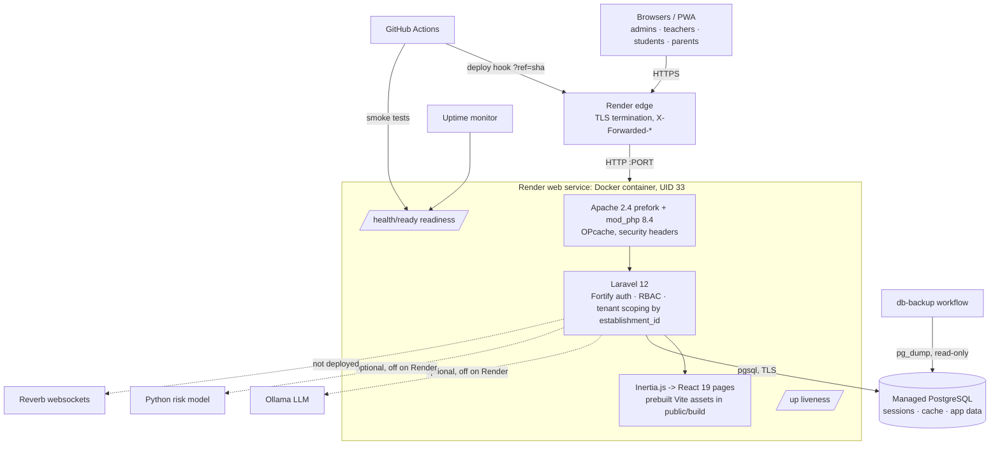

# Architecture

## Components

| Component | Notes |
|---|---|
| Web | One container: Apache + mod_php. No separate frontend server — Inertia renders React pages from Laravel responses. |
| State | **All durable state is in PostgreSQL**: data, sessions (`SESSION_DRIVER=database`), cache (`CACHE_STORE=database`). The container is disposable. |
| Files | Uploaded submissions are on local disk → **lost on redeploy on Render** until object storage is configured (audit F7). |
| Background work | None. `QUEUE_CONNECTION=sync`; no scheduled tasks. |
| AI | Academic assistant falls back to a rule-based provider; risk analysis falls back to a rule engine when Python/ML is unavailable. Both log a warning (class name only, no student data). |

## Multi-tenancy and data isolation review

* Model: shared database, `establishment_id` on 21 models; scoping is enforced in services/controllers
  (no global scope). Feature tests cover isolation for dashboards, schedules, grades, finance PDFs,
  messaging, parents and risk API — they pass on PostgreSQL.
* Risk: isolation depends on every query remembering the filter. A global `EstablishmentScope` would make
  it default-deny; recommended, not implemented (business-logic change).
* Health endpoints return only `ok/fail` + latency + release — no tenant, host or error data (tested).
* Logs: warning/error contexts contain exception class names and HTTP status codes only.
* Cache: the application does not use `Cache::` directly, so there are no tenant-unprefixed keys.
* Sessions are per user in the database; readiness probes do not create sessions (tested).

## Request path security
TLS ends at Render; Laravel trusts the proxy headers (`trustProxies('*')`, safe because the container is
only reachable through Render's proxy) so URLs, redirects and `Secure` cookies use HTTPS.
