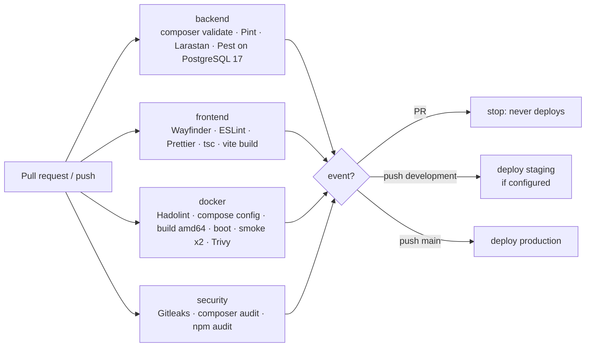

# CI/CD Pipeline

Workflows in `.github/workflows/`:

| File | Trigger | Purpose |
|---|---|---|
| `ci.yml` | PR, push to `main` / `development`, manual | 4 gating jobs + deploy jobs |
| `deploy-render.yml` | called by `ci.yml`, manual (rollback) | Deploy one SHA to Render and verify it |
| `security-scheduled.yml` | Mondays 05:17 UTC, manual | Full-history secrets, audits, fresh-image Trivy |
| `db-backup.yml` | Daily 02:30 UTC, manual | Encrypted off-site DB backup |
| `.github/dependabot.yml` | weekly | Composer, npm, Actions, Docker, Compose updates |

## Jobs

**backend** — PHP 8.4 with the extensions the image uses; Composer cache keyed on `composer.lock`;
`composer validate`; `pint --test`; Larastan level 5 with `phpstan-baseline.neon` (262 pre-existing
findings baselined, *new* findings fail); Pest against a **PostgreSQL 17 service container**
(production parity — SQLite silently accepts some invalid SQL, see F10 in the audit). JUnit report →
job summary + artifact.

**frontend** — Node 22, `npm ci` (lockfile only); Wayfinder needs PHP + vendor to generate typed
route files before ESLint/tsc can resolve imports; then lint, format check, type check, production build.
There is no frontend unit-test runner in the project yet; adding Vitest is a recommended follow-up.

**docker** — Hadolint (config `.hadolint.yaml`), `docker compose config`, Buildx build for
`linux/amd64` with GitHub Actions layer cache, `docker compose up --wait` (app + PostgreSQL), smoke
test in local mode, a second container in **production mode behind a simulated TLS proxy**
(asserts https URLs, Secure cookies, HSTS), entrypoint safety checks, Trivy:
report HIGH+CRITICAL, **fail on fixable CRITICAL**, misconfig report. Logs + reports as artifacts.

**security** — Gitleaks over the commits of the push/PR (full history weekly), `composer audit`
(fails on any advisory), `npm audit --omit=dev --audit-level=high` (fails), dev-dependency audit as warning.

## Standards applied

* Every third-party action pinned to a **full commit SHA** with the version in a comment; Dependabot bumps them.
* Scanners run from **digest-pinned images**. `aquasecurity/trivy-action` is deliberately *not* used
  (tags were hijacked in March 2026, CVE-2026-33634).
* `permissions: contents: read` at workflow level; no job needs more. `persist-credentials: false` on checkout.
* Untrusted event values are passed through `env:`, never interpolated into scripts.
* PR runs are cancelled when superseded; `main` runs and deploys are never cancelled.
* Deploys: concurrency group per environment, specific SHA, post-deploy verification.

## Validation status

| | |
|---|---|
| actionlint (incl. ShellCheck of `run:` blocks) | **Passed locally** (v1.7.12) |
| Each job's commands | **Executed locally** (Docker Desktop) — see the final report |
| Real GitHub Actions run | PR #1, first run: frontend, docker, security green; backend 152/154 — the 2 `PwaTest` failures needed built assets, fixed by building them in the backend job |

**Known risk:** the uncommitted local change to `app/Models/Attendance.php` (`student()` →
`StudentProfile`) fails `AttendanceManagementTest` on PostgreSQL. If it is committed as is, the
backend job turns red and deploys are blocked — intentionally.
