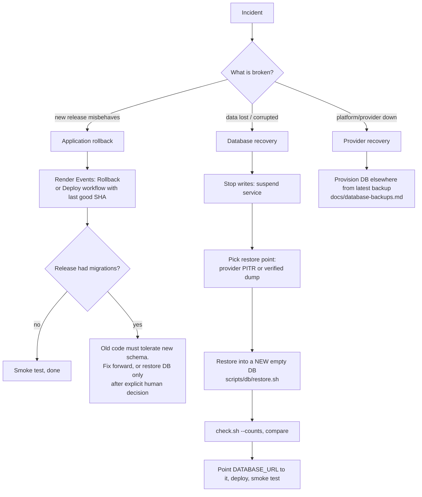

# Rollback and Disaster Recovery

**Application rollback and database recovery are separate decisions.** Rolling back code never
restores a database snapshot, and nothing in this repository restores a database automatically.

## Application rollback (minutes)
1. Render → service → **Events** → previous successful deploy → **Rollback**, *or*
   GitHub → Actions → **Deploy to Render** → Run workflow → `production` + last good SHA.
2. Watch the job: smoke test must report the expected release.
3. Revert the bad commit on `main` (so the next push does not redeploy it).

Render keeps the previous version serving when a new build or health check fails, so a failed
deploy is not an outage; check the job summary to see what failed.

## Failed deployment handling
| Symptom | Action |
|---|---|
| Build failed | Fix forward; nothing changed in production |
| Health check failed (`/up`) | Render did not switch traffic; read the boot logs (entrypoint prints the reason) |
| Smoke test failed after `live` | Roll back (above) then investigate |
| Migration failed at boot | Container exits, previous version keeps serving. Fix the migration; never edit the DB by hand without a backup |

## Database recovery
1. Decide a restore point. Options: provider PITR (paid Render: last 3/7 days), last verified dump
   (`backups/` or the encrypted `db-backup` artifact), provider logical export.
2. Restore **into a new empty database** — never over the live one: `scripts/db/restore.sh … --confirm <new-db>`.
3. Verify counts; spot-check recent records with a school administrator.
4. Switch `DATABASE_URL`, redeploy, smoke test. Keep the damaged DB for analysis.

**Data recovery limits:** anything written after the restore point is lost; Render Free has no
backups at all; the daily workflow gives an RPO of ≤ 24 h, provider PITR an RPO of minutes.
Uploaded files are **not** in database backups (and are currently ephemeral).

## Configuration recovery
Everything except secrets is in git (`render.yaml`, `Dockerfile`, workflows). Secrets to re-create:
`APP_KEY` (**must be the original** — a new key invalidates sessions and 2FA secrets; store it in a
password manager), `DATABASE_URL`, deploy hooks, `RENDER_API_KEY`, backup GPG key pair.

## Recovery checklist
- [ ] Incident owner named, start time noted
- [ ] Scope: app vs data vs provider
- [ ] Backup of the current state taken before any change
- [ ] Rollback or restore executed, smoke test green
- [ ] Users informed; post-incident note added to `docs/render-outage-investigation.md`

| Target | Value (current setup) |
|---|---|
| RTO (app) | ~5–15 min (Render rebuild) |
| RPO (data) | ≤ 24 h with daily backups; minutes with paid PITR; **unbounded on Render Free** |
